# YouTube Automation Workflow - Visual Diagrams

This document contains visual representations of the YouTube automation workflow using Mermaid diagrams.

---

## 1. High-Level Workflow Overview

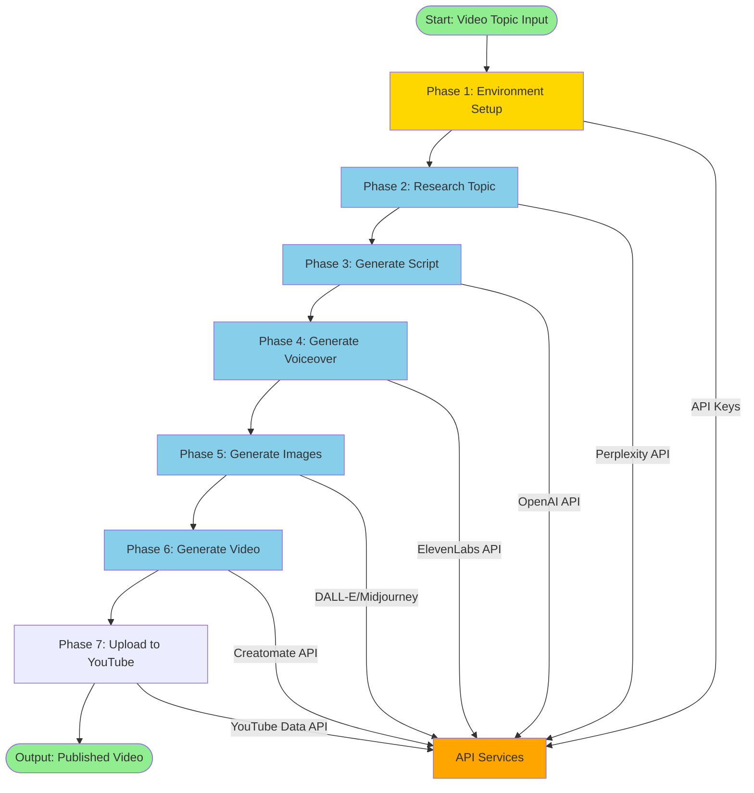

---

## 2. Detailed Process Flow

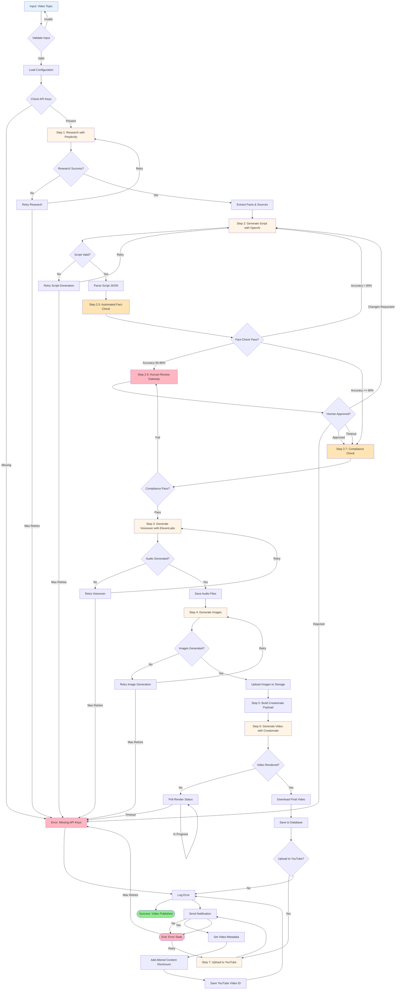

---

## 3. System Architecture

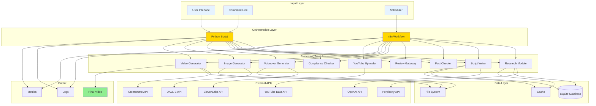

---

## 4. n8n Workflow Structure

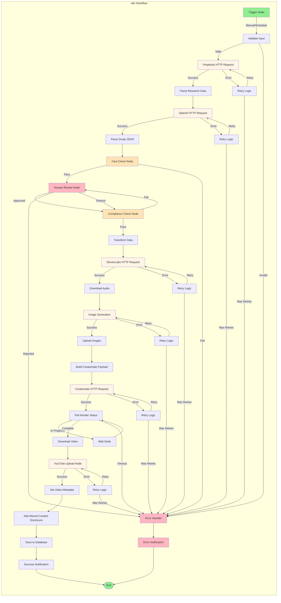

---

## 5. Data Flow Diagram

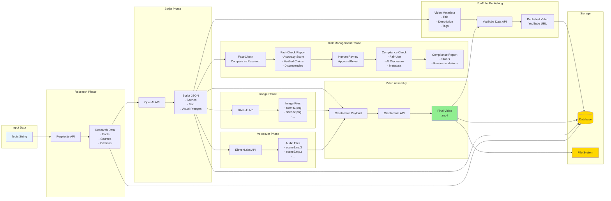

---

## 6. Error Handling Flow

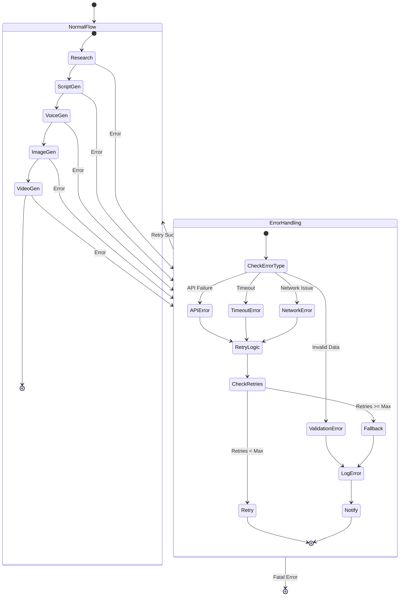

---

## 7. Phase-by-Phase Development Flow

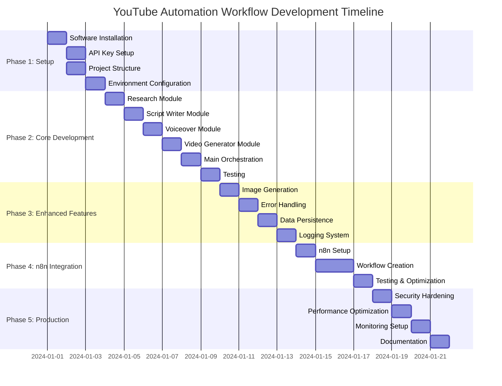

---

## 8. Component Interaction Sequence

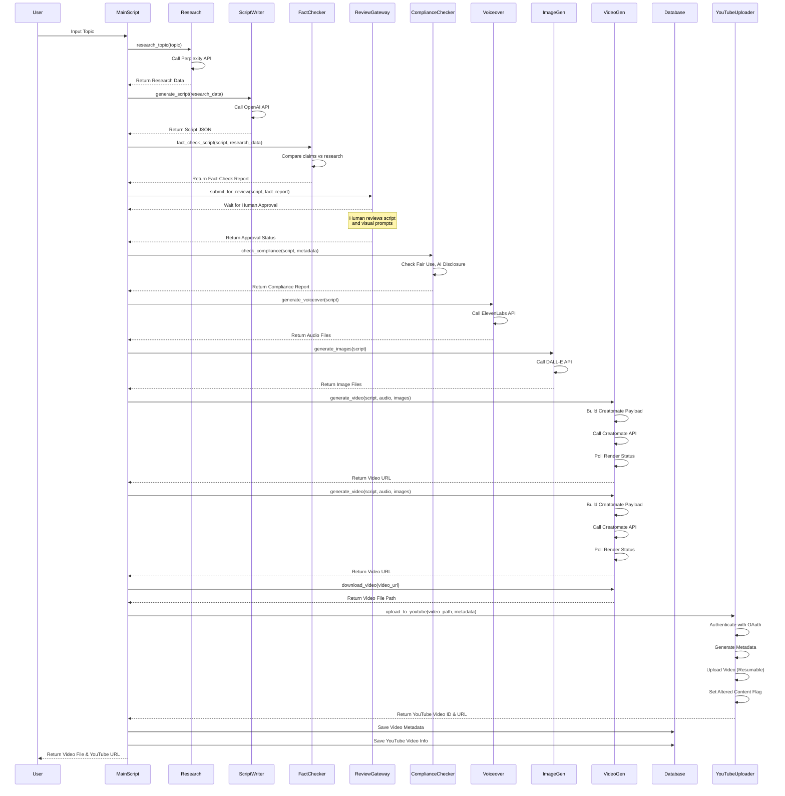

---

## 9. Decision Tree for Workflow Execution

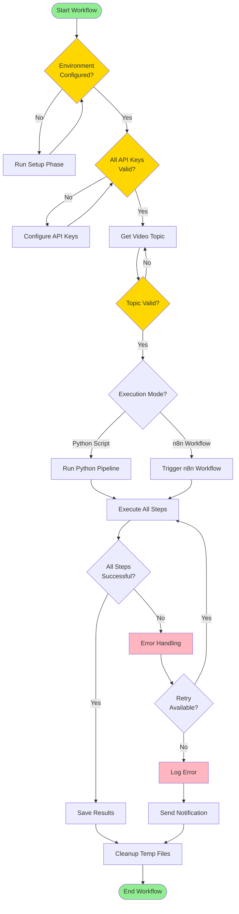

---

## 10. Cost Flow Diagram (Optimized)

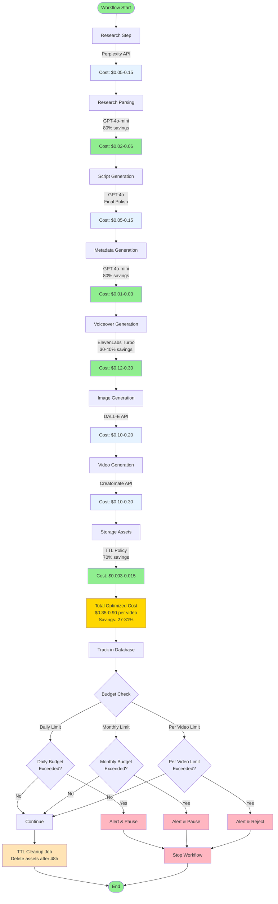

---

## 11. Cost Optimization Strategy Diagram

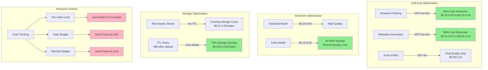

---

## How to View These Diagrams

### In Markdown Viewers
- **GitHub**: Automatically renders Mermaid diagrams
- **VS Code**: Install "Markdown Preview Mermaid Support" extension
- **GitLab**: Native support for Mermaid
- **Notion**: Supports Mermaid diagrams

### Online Viewers
- **Mermaid Live Editor**: https://mermaid.live/
- Copy any diagram code and paste it into the editor

### Export Options
- Use Mermaid CLI to export as PNG/SVG
- Use online tools to convert to images
- Some IDEs can export diagrams directly

---

## Diagram Legend

### Colors Used
- 🟢 **Green**: Start/End points, Success states
- 🔵 **Blue**: Input/Output data, Information
- 🟡 **Yellow**: Processing steps, Important nodes
- 🟠 **Orange**: External services, APIs
- 🔴 **Red**: Error states, Failures

### Node Types
- **Rectangle**: Process/Step
- **Diamond**: Decision point
- **Rounded Rectangle**: Start/End
- **Cylinder**: Database
- **Parallelogram**: Input/Output

---

## Notes

- All diagrams are interactive in supported viewers
- Diagrams can be customized by editing the Mermaid code
- Use these as reference when building the actual workflow
- Update diagrams as the workflow evolves
